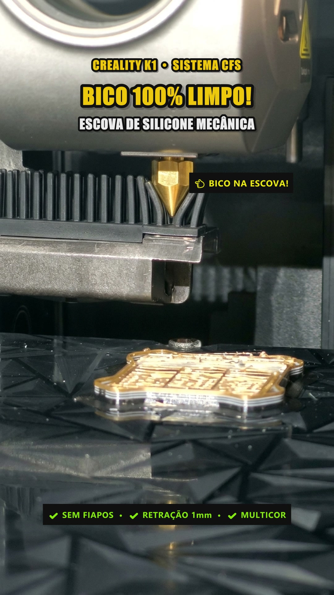
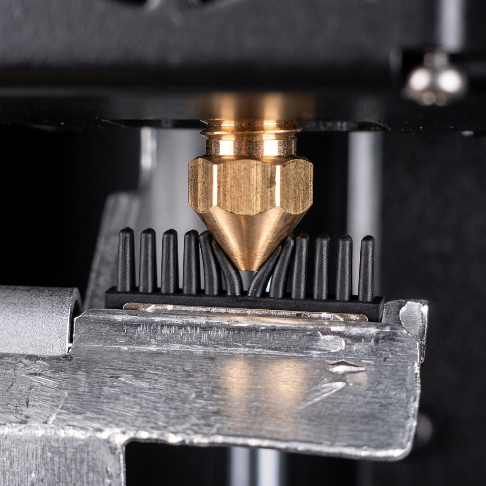

# 🧹 Creality K1 / K1C / K1 Max - CFS Safe Nozzle Wiper (v2.0)

[](https://www.klipper3d.org/)
[](https://github.com/SoftFever/OrcaSlicer)
[](https://www.creality.com/)
[](LICENSE)
[](https://youtube.com/shorts/4Iyi-nFR4YI)

Rotina calibrada de **limpeza mecânica de bico com escova de silicone** para impressoras **Creality K1, K1C e K1 Max** equipadas com o sistema multi-cor **CFS (Creality Filament System)**.

A **versão 2.0** traz retração ampliada anti-gotejamento (2.0 mm), ciclo triplo de escovação (36 passadas) e saída lateral pela direita para tosar e soltar qualquer filamento que tente aderir à meia de silicone do hotend.

---

## 📺 Demonstração em Vídeo (YouTube Shorts)

Assista ao ciclo completo em funcionamento na máquina:  
▶️ **[Clique aqui para assistir no YouTube Shorts](https://youtube.com/shorts/4Iyi-nFR4YI)**

<p align="center">
  
  &nbsp;&nbsp;&nbsp;&nbsp;
  
</p>

---

## 🎯 Problemas Resolvidos por Este Mod (v2.0)

1. **Gotejamento & Fiapos Pós-Purga:** O bico purga a 250 °C e fica pressurizado. Com retração insuficiente, o filamento fundido (especialmente PETG) escorre lentamente na viagem e gruda na meia de silicone.
   - *Solução v2.0:* Retração ampliada de **`2.0 mm` a 1800 mm/min (`G1 E-2.0 F1800`)**, quebrando a tensão superficial e o vácuo interno, acompanhado de restauração imediata da temperatura de impressão (`M104 S[target_temp]`).
2. **Filamento Preso na Meia de Silicone:** Sair direto para frente (`Y215`) após a limpeza arrastava qualquer fiapo restante contra a borda frontal da borracha.
   - *Solução v2.0:* **Saída lateral pela direita (`X=180.0`)** antes de recuar. A cabeça varre toda a quina final das cerdas e a borda metálica do suporte, agindo como uma lâmina que corta e desprende o plástico para o duto antes de ir para a frente em campo aberto.
3. **Escovação Insuficiente em Filamentos Grudentos (PETG):**
   - *Solução v2.0:* **Ciclo Triplo de Escovação** — 18 ciclos completos (**36 passadas**) com curso ampliado de **8 mm (`X=164.0` a `X=172.0`)**, limpando tanto a ponta cônica quanto as quinas da meia de silicone.
4. **Risco de Colisão do Eixo Z:** Quando a peça está nas primeiras camadas (`Z < 30 mm`), a mesa levantada pode colidir com o mecanismo móvel da escova de silicone ao acionar a rampa mecânica.
   - *Solução:* **Salvaguarda inteligente de Z suave** — rebaixa a mesa para `Z=30 mm` a suaves `10 mm/s` (`F600`) em campo aberto (`Y=215`), realiza a limpeza e retorna com precisão para a camada exata.
5. **Looping de Corte do CFS (Extrusora Nova):** Em extrusoras novas com molas mais rígidas, o microswitch de corte `PA8` muitas vezes falha no acionamento, travando o firmware em repetições infinitas de corte.
   - *Solução:* Calibração do offset de corte para **`cut_pos_offset = 1.8`** (+0.5 mm).

---

## ⚙️ Parâmetros Calibrados (v2.0)

| Parâmetro | Valor Calibrado | Finalidade |
| :--- | :---: | :--- |
| **Zona Segura Frontal** | `Y = 215.0 mm` | Campo aberto para descida e subida do eixo Z |
| **Centro dos Pinos de Silicone** | `X = 168.0 mm` | Ponto de alinhamento central da escova |
| **Engate Traseiro da Rampa** | `Y = 226.3 mm` | Pressiona a rampa e ergue a escova contra o bico |
| **Amplitude de Esfregada** | `X = 164.0` a `172.0` | Curso ampliado de 8 mm cobrindo bico e meia de silicone |
| **Ciclos de Limpeza** | `18 ciclos (36 passadas)` | Velocidade de 60 mm/s (`F3600`) com atrito mecânico triplicado |
| **Saída Lateral Direita** | `X = 180.0 mm` | Tosquia e desgarra qualquer resíduo antes de avançar para frente |
| **Retração Anti-Gotejamento** | `2.0 mm` a 30 mm/s | Despressuriza completamente a câmara térmica do bico |
| **Velocidade de Salvaguarda Z** | `10 mm/s (F600)` | Movimento suave sem trancos ou perda de passos |
| **Offset da Alavanca de Corte** | `cut_pos_offset = 1.8` | Acionamento firme do sensor de corte na nova extrusora |

---

## 🚀 Como Instalar

### 1. Inserir a Macro no Klipper (`box.cfg`)

Abra o arquivo `box.cfg` pelo painel web do Fluidd / Mainsail / CrealityOS e adicione a macro `CFS_SAFE_WIPE` (disponível em [`macros/cfs_safe_wipe.cfg`](macros/cfs_safe_wipe.cfg)):

```gcode
[gcode_macro CFS_SAFE_WIPE]
description: Limpeza profunda nos pinos de silicone do CFS (v2: retracao 2mm, 36 passadas e saida lateral direita)
gcode:
  G90
  M400
  
  ; 1. Salva a altura Z real da peca sendo impressa
  

  ; 2. Retracao rapida de 2.0mm anti-gotejamento
  
    G91
    G1 E-2.0 F1800
    G90
    M400
  

  ; 3. Restaura temperatura de impressao (sai dos 250C da purga)
  
  
    M104 S{target_temp}
  

  ; 4. Avanca a cabeca para frente em Y215 (zona segura)
  G1 Y215 F6000
  M400

  ; 5. Salvaguarda de Z suave (se Z < 30mm)
  
    G1 Z30 F600
    M400
  

  ; 6. Centraliza no centro dos pinos de silicone
  G1 X168 F6000
  M400

  ; 7. Engate traseiro erguendo a escova
  G1 Y226.3 F3000
  M400

  ; 8. Escovacao profunda: 18 ciclos (36 passadas ampliadas de 8mm a 60 mm/s)
  
    G1 X164.0 F3600
    G1 X172.0 F3600
  
  M400

  ; 9. Saida lateral pela direita tosquiando o filamento da meia de silicone
  G1 X180.0 F4800
  M400

  ; 10. Desengata para a frente para a zona de seguranca
  G1 Y215 F6000
  M400

  ; 11. Restaura Z para a camada exata a 10 mm/s
  
    G1 Z{orig_z} F600
    M400
  
```

### 2. Chamada Automática nas Trocas do CFS

Ainda em `box.cfg`, certifique-se de chamar a macro `CFS_SAFE_WIPE` logo após as purgas do CFS:

```gcode
[gcode_macro BOX_LOAD_MATERIAL_WITH_MATERIAL]
gcode:
  # ... rotina padrao de purga ...
  BOX_EXTRUDE_MATERIAL
  BOX_EXTRUDER_EXTRUDE
  ; --- CHAMA LIMPEZA CALIBRADA V2 ---
  CFS_SAFE_WIPE
  RESTORE_POSITION
```

### 3. Configuração no OrcaSlicer / Creality Print

No seu fatiador, acesse as configurações de cada filamento (**Filament Settings -> Filament Start G-code**) e insira:

```gcode
CFS_SAFE_WIPE TARGET_TEMP=[nozzle_temperature]
```

Isso garante que ao final da purga nativa (que roda a 250 °C), o bico retorne imediatamente para a temperatura correta de impressão (ex: 220 °C para PLA, 230 °C para ABS, 245 °C para PETG).

---

## 🧪 Teste a Seco (Macro Didática)

Para testar a cinemática, o alinhamento da escova e a saída lateral pela direita a frio (sem aquecer o bico e sem risco), adicione e execute a macro `TESTE_LIMPEZA_BICO`:

```gcode
[gcode_macro TESTE_LIMPEZA_BICO]
description: Teste visual a seco do movimento de limpeza na escovinha do CFS (v2.0: mesa em Z60, 36 passadas e saida lateral direita)
gcode:
  ; 1. Garante o Home dos eixos antes de qualquer movimento
  IF_NEED_HOME
  G90
  
  ; 2. SEGURANCA: Abaixa a mesa para Z=60mm suavemente (F1200) para dar visao desimpedida
  G1 Z60 F1200
  M400

  ; 3. Posiciona no buraco da purga (simula o bico saindo do bueiro)
  G1 X148 Y226.5 F4000
  G4 P1500 ; Pausa de 1.5s para inspecao visual

  ; 4. Avanca a cabeca para a frente em Y215 (campo aberto e seguro)
  G1 Y215 F4000
  G4 P500

  ; 5. Desloca para X168 (alinhado no centro dos pinos de silicone)
  G1 X168 F4000
  G4 P500

  ; 6. Engata suavemente na escova (Y226.3 aciona a rampa mecanica e eleva os pinos)
  G1 Y226.3 F2500
  G4 P500

  ; 7. Escovacao profunda: 18 ciclos completos (36 passadas de 8mm a 60 mm/s)
  
    G1 X164.0 F3600
    G1 X172.0 F3600
  
  M400

  ; 8. SAIDA PELA DIREITA: Varre ate o canto direito (X180) tosquiando qualquer fiapo
  G1 X180.0 F4800
  G4 P800 ; Pausa no ponto de tosa

  ; 9. Desengata para a frente para a zona de seguranca (Y215)
  G1 Y215 F4000
  M400

  ; 10. Volta ao centro da mesa
  G1 X110 Y110 F6000
  M400
  {action_respond_info("--> Teste de limpeza v2.0 finalizado com 100% de sucesso!")}
```

A macro conta com **pausas visuais programadas** para que você possa acompanhar cada etapa (buraco de purga, alinhamento, engate, escovação e tosa lateral) com os olhos e 100% a frio.

---

## 🤝 Contribuições

Contribuições são muito bem-vindas! Se você testou na **K1 Max** ou **K1C**, ou calibrou parâmetros para bicos de alto fluxo / materiais especiais como TPU, abra uma [Issue](https://github.com/Demolidor31br/creality-k1-cfs-nozzle-wiper/issues) ou envie um Pull Request.

---

## 📄 Licença

Distribuído sob a licença **MIT**. Veja [`LICENSE`](LICENSE) para mais detalhes.

Desenvolvido por **Ivan Marcos ([@Demolidor31br](https://github.com/Demolidor31br))**.
